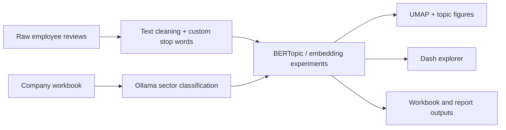
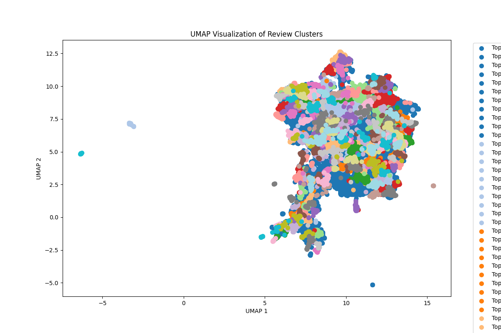
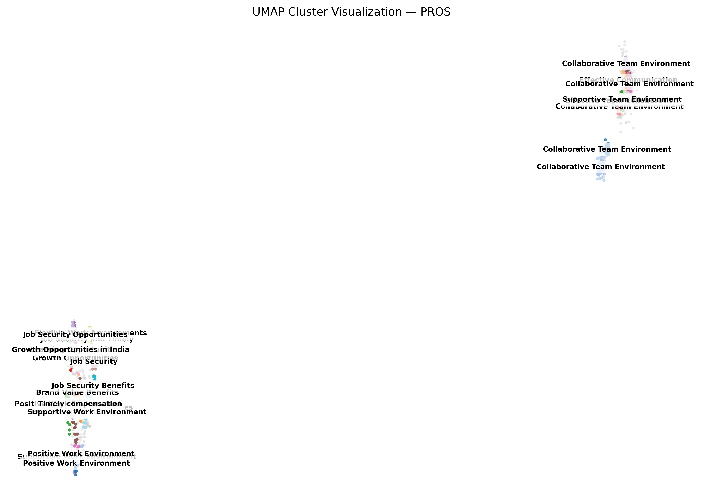

# Topic Modelling and Employee Review Analysis

An NLP internship project for turning Glassdoor-style employee reviews into cleaned text, company sectors, sentiment/topic clusters, visual summaries, spreadsheets, and an interactive Dash explorer.

The repository is an organized research archive: it preserves the scripts and representative outputs that can be shared on GitHub while large source datasets and videos remain in the original Drive folders.

## Workflow



## Example outputs

### Review clusters



### Pros clusters



The repository also includes focused topic, sentiment-cluster, and confidence plots under [`outputs/figures/fedex_ambition/`](outputs/figures/fedex_ambition/), plus the generated [classification workbook](outputs/spreadsheets/classify.xlsx).

## What I built

- Cleaning and EDA scripts for review text, ratings, dates, missing values, duplicates, and company distributions.
- Resume-safe company-sector classification through local Ollama models.
- BERTopic, sentence-transformer, UMAP, and HDBSCAN experiments for pros/cons topic discovery.
- Plotly/Dash exploration of topic clusters and representative reviews.
- Report and spreadsheet generation for communicating findings.

## Repository map

```text
.
├── data/raw/                 # Large source data is not committed
├── outputs/
│   ├── figures/              # Committed representative visualizations
│   └── spreadsheets/         # Classification workbook
├── reports/
│   └── eda_glassdoor.docx
├── src/                      # Cleaning, EDA, modelling, reports, dashboard
├── archive/drive-folders/    # Placeholder for archived Drive material
└── requirements.txt
```

## Environment

The pinned environment records a CUDA 12.1 PyTorch stack. On a compatible Linux GPU machine:

```bash
git clone https://github.com/Sagankaur/topic-modelling.git
cd topic-modelling
python -m venv .venv
source .venv/bin/activate
python -m pip install --upgrade pip
python -m pip install --extra-index-url https://download.pytorch.org/whl/cu121 -r requirements.txt
```

For CPU-only use, install the PyTorch build recommended by the [official selector](https://pytorch.org/get-started/locally/) and install the remaining packages without the three `torch*` pins.

Some NLP paths also require local resources:

```python
import nltk
nltk.download("stopwords")
nltk.download("wordnet")
```

`src/classify.py` expects a running [Ollama](https://ollama.com/) installation with `llama3.1:8b`.

## Run individual components

Several scripts preserve the original Windows paths from the internship workstation. Change their input/output constants or CLI arguments to point to your local files before running them.

Launch the committed dashboard after producing a directory containing `clusters.csv` and `topic_summary.csv`:

```bash
python -m pip install dash
python src/dashboard.py --input_dir /path/to/topics_output
```

Then open <http://127.0.0.1:8050>.

The main inputs are intentionally absent because they are large and may contain third-party review data. The original project folders are linked below:

- [Original Drive folder](https://drive.google.com/drive/folders/1XfbC_M6OK70448Hpm130Vstqm69WH3HG)
- [Additional internship work](https://drive.google.com/drive/folders/1AFg-GrGi47McAk9mDwD9dM-tb6S8hMvN)

## Reproducibility status

- Representative figures, the classification workbook, source scripts, and the EDA report are committed.
- `updated_glassdoor_data.csv`, the source archive, video, and large generated outputs remain outside Git because of size and data-handling constraints.
- `src/full_pipe.py` documents the intended orchestration, but its current defaults are workstation-specific and it references historical filenames that are not present in this trimmed repository. Use the individual scripts as the reliable record of implemented stages.
- No quantitative model-quality benchmark is committed, so this README intentionally does not claim accuracy or topic-coherence scores.

## Limitations

- Topic labels are exploratory and can change with embeddings, random seeds, stop words, and clustering parameters.
- Employee-review data is self-selected and should not be treated as a representative workforce survey.
- Local LLM sector assignments require manual validation, especially for ambiguous company names.
- Sharing the full pipeline requires access to the external datasets and path/config cleanup.
